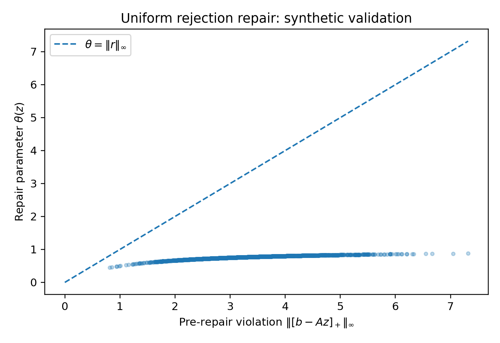
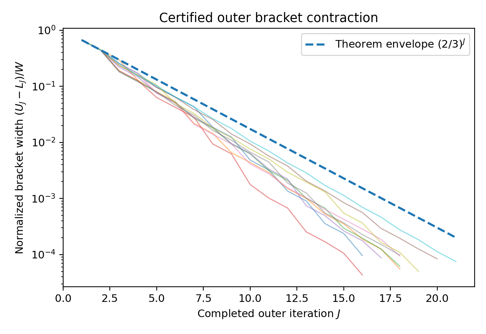
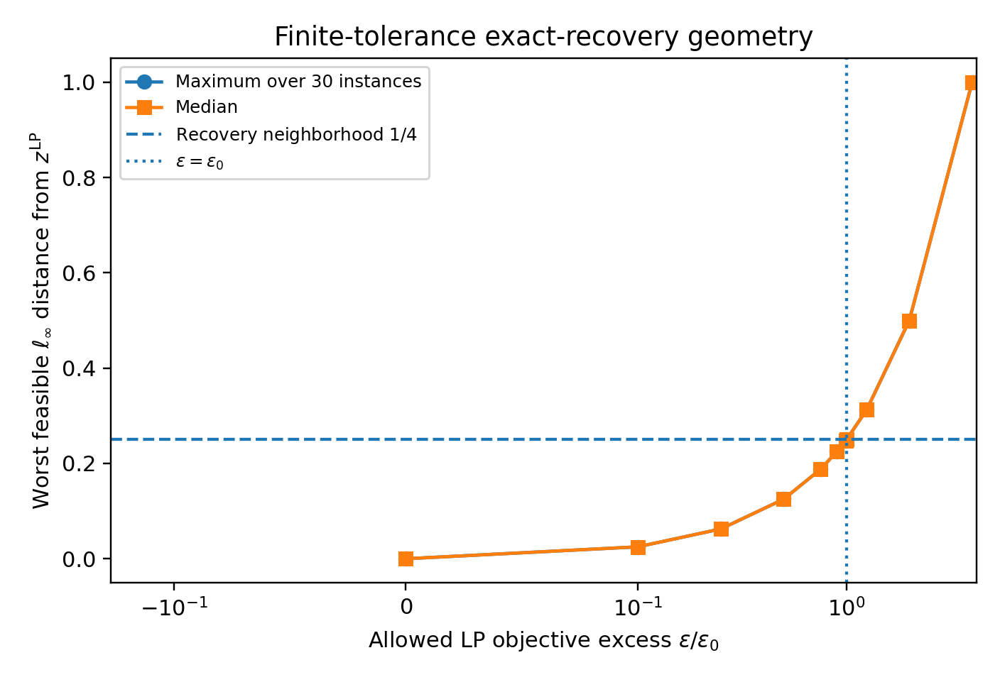
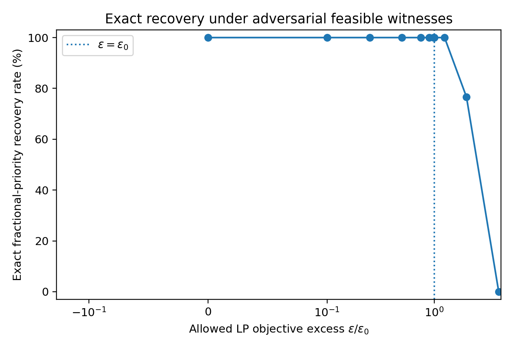
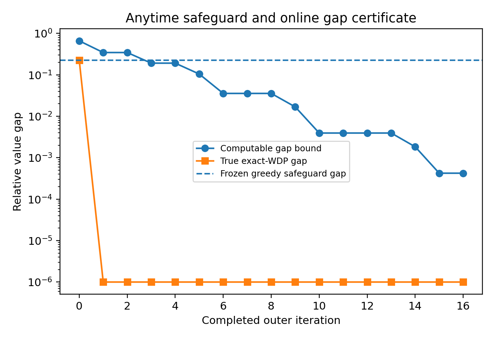

# Synthetic theorem-support experiments for SC-WDP

This repository accompanies the paper:

Sparse Convex Optimization for Winner Determination: Approximation Guarantees and Anytime Dominance

It contains only synthetic numerical experiments designed to support theorem-specific claims of the proposed SC-WDP framework. It does not reproduce the external CATS benchmark comparison and does not contain external baseline implementations.

## What is tested

The scripts generate synthetic WDP instances and numerically check:

1. constructive exactness of the continuous weighted-support rejection formulation;
2. the uniform rejection repair and its bound on the repair parameter;
3. preservation and geometric contraction of the outer LP-optimum bracket;
4. the finite-tolerance exact-recovery mechanism for a unique integral LP optimum;
5. monotone retained-incumbent dominance and the online exact-WDP gap certificate.

The proofs remain the authoritative statements. The numerical outer solver uses IEEE double precision and is included as a transparent reference implementation for these synthetic diagnostics.

## Main plots

### Figure S1. Uniform rejection repair: synthetic validation

This plot compares the pre-repair violation
`||[b - Az]_+||_infinity`
with the repair parameter
`theta(z) = ||r||_infinity`.
All points lie far below the identity line, consistent with the repair bound proved in the paper.



### Figure S2. Certified outer bracket contraction

These synthetic runs illustrate preservation of the LP-optimum bracket together with contraction of the bracket width. The dashed line is the theorem envelope proportional to `(2/3)^J`.



### Figure S3. Finite-tolerance exact-recovery geometry

This figure shows how the feasible witness approaches the unique integral LP optimum as the allowed LP objective excess is reduced relative to the theorem threshold `epsilon0`.



### Figure S3b. Exact-recovery rate under adversarial feasible witnesses

Across the synthetic family, exact recovery is perfect throughout the tested regime `epsilon < epsilon0`, and then degrades once the theorem regime is violated.



### Figure S4. Anytime safeguard and online gap certificate

This representative trace compares the computable online value-gap certificate with the true exact-WDP gap and the frozen greedy safeguard gap. The online certificate remains a valid upper bound while tightening substantially during the run.



## Repository layout

- `src/scwdp.py` - compact Python implementation of the theorem-facing SC-WDP components.
- `scripts/run_synthetic.py` - fixed-seed experiment driver; regenerates all CSV files and figures.
- `data/` - generated raw and summary CSV files.
- `figures/` - generated PDF and PNG figures used by the supplement.
- `supplement/supplement.tex` - LaTeX source of the supplementary material.
- `supplement/supplement.pdf` - compiled supplementary material.
- `requirements.txt` - Python dependencies.
- `run_all.sh` - one-command regeneration of data, figures, and the supplement PDF.

## Reproduce

Use Python 3.11 or later.

```bash
python -m pip install -r requirements.txt
python scripts/run_synthetic.py
cd supplement
pdflatex -interaction=nonstopmode -halt-on-error supplement.tex
pdflatex -interaction=nonstopmode -halt-on-error supplement.tex
```

Or run:

```bash
bash run_all.sh
```

The random seed is fixed to `20261012` in `scripts/run_synthetic.py`.

## Expected regression checks

A successful run should report:

- 500/500 weighted-support thresholding tests with zero objective discrepancy;
- 2,000/2,000 repair tests with no inequality violation beyond floating-point roundoff;
- all 10 bracket traces containing the independently solved LP optimum and lying below the `(2/3)^J` envelope;
- 30 unique-integral-LP instances with 100% exact recovery for every tested `epsilon/epsilon0 < 1`;
- the online gap certificate never below the independently evaluated exact-WDP gap in the representative trace.

No Rust toolchain is required; the repository is pure Python plus LaTeX.
